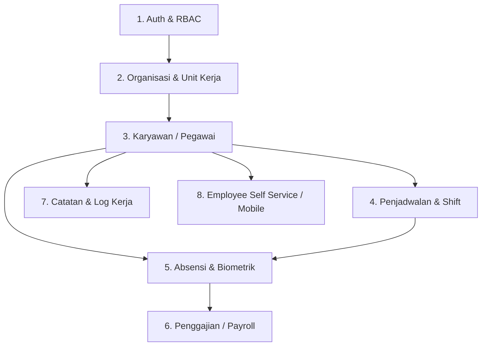

# 🗺️ Peta Domain & Arsitektur HRMS-Pro (Domain Map)

Dokumen ini adalah *Single Source of Truth* mengenai pembagian domain, kepemilikan file, tabel database terkait, dan alur integrasi pada sistem HRMS-Pro. Gunakan dokumen ini sebagai acuan saat menambah fitur atau melakukan refactoring.

---

## 1. Daftar Domain Utama

---

## 2. Rincian per Domain

### 🔐 1. Authentication & RBAC (Role-Based Access Control)
* **Tanggung Jawab:** Manajemen login, session JWT, refresh token, role-based navigation, izin menu (permission guards).
* **Komponen & UI:**
  * `components/Login.tsx`, `components/ForgotPassword.tsx`, `components/ChangePassword.tsx`
  * `components/guards/RoleRouteGuard.tsx`
* **Hooks & Services:**
  * `services/AuthService.ts`, `services/rbacService.ts`
  * `hooks/useAuthHandlers.ts`
* **Tabel Terkait:** `auth.users`, `roles`, `permissions`, `role_permissions`, `user_roles`
* **Jalur Akses:** Supabase Auth SDK + RLS.

---

### 🏢 2. Organisasi & Unit Kerja (Organization & Work Units)
* **Tanggung Jawab:** Struktur organisasi rumah sakit, hierarki unit kerja, konfigurasi shift per unit, penugasan Kepala Ruangan.
* **Komponen & UI:**
  * `components/OrganizationSettings.tsx`, `components/WorkUnitManagement.tsx`
  * `components/organization/*`
* **Hooks & Services:**
  * `hooks/useOrganizationHandlers.ts`
  * `server/routes/organizationRoutes.js`
* **Tabel Terkait:** `work_units`, `departments`, `positions`, `unit_heads`

---

### 👥 3. Karyawan & Master Data (Employee Management)
* **Tanggung Jawab:** Biodata karyawan, riwayat jabatan, upload foto, cetak ID Card, import/export Excel master karyawan.
* **Komponen & UI:**
  * `components/EmployeeTable.tsx`, `components/EmployeeForm.tsx`, `components/EmployeeDetail.tsx`
  * `components/EmployeeIdCardModal.tsx`, `components/ImportPreviewModal.tsx`
  * `components/employee-form/*`, `components/employee-detail/*`
* **Hooks & Services:**
  * `hooks/useEmployeeCRUD.ts`, `hooks/useEmployeeForm.ts`, `hooks/useEmployeeImport.ts`
  * `services/nikService.ts`, `services/documentService.ts`
  * `server/routes/employeeRoutes.js`
* **Tabel Terkait:** `employees`, `employee_documents`, `employee_audit_logs`

---

### 📅 4. Penjadwalan & Shift (Scheduling & Roster)
* **Tanggung Jawab:** Pembuatan roster bulanan, master pola rotasi (P/S/M/L), auto-generation jadwal bertahap (stagger), tukar shift, publish/unpublish jadwal unit kerja.
* **Komponen & UI:**
  * `components/UnitScheduleManagement.tsx`, `components/ScheduleCalendarPanel.tsx`
  * `components/RotationPatternPanel.tsx`, `components/ShiftConfigPanel.tsx`
  * `components/unit-schedule/*`
* **Hooks & Services:**
  * `hooks/useUnitScheduleManagement.ts`
  * `services/scheduleService.ts`, `services/shiftSwapService.ts`
* **Tabel Terkait:** `schedules`, `shift_definitions`, `rotation_patterns`, `shift_swaps`

---

### ⏰ 5. Absensi, Biometrik & Kehadiran (Attendance & Biometrics)
* **Tanggung Jawab:** Log presensi masuk/pulang, verifikasi selfie + geolokasi (GPS haversine), integrasi terminal wajah Hikvision ISAPI, integrasi fingerprint U.are.U (DigitalPersona).
* **Komponen & UI:**
  * `components/AttendanceManagement.tsx`, `components/AttendanceVerificationFlow.tsx`
  * `components/HikvisionPanel.tsx`, `components/UareUFingerprintModal.tsx`, `components/SelfieCamera.tsx`
  * `components/attendance/*`, `components/fingerprint/*`, `components/hikvision/*`
* **Hooks & Services:**
  * `hooks/useAttendanceHandlers.ts`, `hooks/useAttendanceStats.ts`, `hooks/useAttendanceVerification.ts`
  * `services/hikvisionService.ts`, `services/uareuFingerprintService.ts`, `services/livenessDetectionService.ts`, `services/faceVerificationService.ts`
  * `server/routes/hikvisionRoutes.js`
* **Tabel Terkait:** `attendance_logs`, `biometric_templates`, `hikvision_devices`

---

### 💵 6. Penggajian & Tunjangan (Payroll & Remuneration)
* **Tanggung Jawab:** Komponen gaji pokok, tunjangan fungsional, potongan keterlambatan/absen, kalkulasi lembur shift, cetak slip gaji (Payslip PDF).
* **Komponen & UI:**
  * `components/PayrollManagement.tsx`, `components/PayslipDetail.tsx`
* **Hooks & Services:**
  * `services/payrollService.ts`
* **Tabel Terkait:** `payrolls`, `payroll_items`, `salary_components`

---

### 📝 7. Catatan Kerja & Supervisi (Notes & Audit)
* **Tanggung Jawab:** Catatan berkala pegawai (pembinaan, evaluasi, penghargaan), log audit sistem, pengumuman portal.
* **Komponen & UI:**
  * `components/NotesPanel.tsx`, `components/AuditLogViewer.tsx`, `components/AnnouncementsPanel.tsx`
  * `components/notes/*`, `components/audit-log/*`
* **Hooks & Services:**
  * `hooks/useAuditLogs.ts`
  * `services/employeeNotesService.ts`, `services/auditLogService.ts`, `services/globalNotificationService.ts`
* **Tabel Terkait:** `employee_notes`, `audit_logs`, `announcements`

---

### 📱 8. Mobile Absensi & ESS (Employee Self-Service)
* **Tanggung Jawab:** Portal mobile khusus pegawai untuk absen selfie/GPS, pengajuan izin/cuti/lembur/tukar shift, riwayat jadwal perorangan.
* **Aplikasi:**
  * `mobile-absensi/` (React Native / Expo SDK 52)
  * `components/EmployeeSelfService.tsx`, `components/MobileBottomNav.tsx`
* **Hooks & Services:**
  * `hooks/useESSAttendance.ts`, `hooks/useESSData.ts`, `hooks/useRequestHandlers.ts`
* **Tabel Terkait:** `leave_requests`, `overtime_requests`, `shift_swap_requests`
